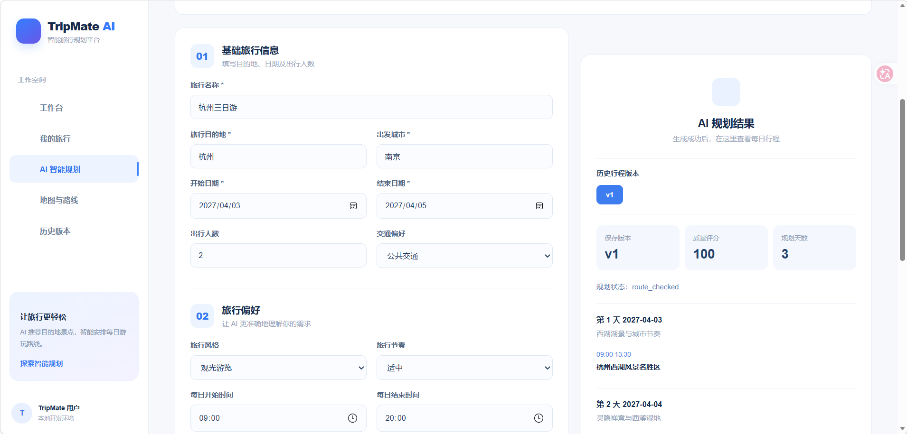
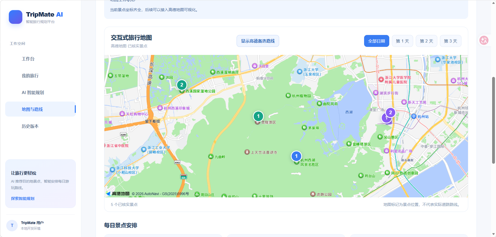
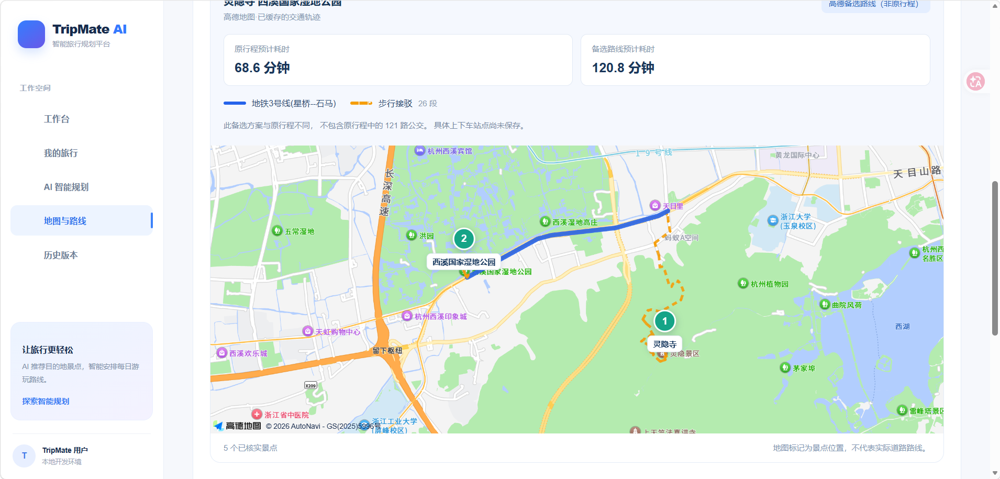

# TripMate AI  智能旅行规划 Agent

基于 **LangGraph + FastAPI + Vue 3 + MySQL + 高德地图** 构建的智能旅行规划平台。

系统将大语言模型的行程生成能力与真实地理信息服务相结合，实现旅行需求管理、AI 多步骤规划、景点验证、交通路线校验、地图可视化以及历史行程版本管理。

> 项目定位：AI Agent 应用开发与工程化实践项目。

## 一、项目功能

### 1. AI 智能旅行规划

- 输入旅行目的地、日期、人数及个性化偏好。
- 使用 LangGraph 编排多节点旅行规划流程。
- 生成按日期组织的景点安排和行程说明。
- 结合质量检查与路线校验，辅助发现不合理规划。

### 2. 景点发现与真实性验证

- 对接高德地图 POI 搜索服务。
- 验证景点名称、地理位置和坐标。
- 使用真实 POI 数据辅助旅行规划。
- 对部分已验证地点和路线进行本地缓存，减少重复请求。

### 3. 交通路线规划

- 支持步行路线与公共交通方案查询。
- 结合高德地图提供的交通信息进行路线分析。
- 对交通时间冲突、数据缺失等情况进行检查。
- 区分历史行程与新查询得到的备选交通路线。

### 4. 交互式地图

- 基于高德地图 JavaScript API 展示真实地图。
- 按旅行日期筛选景点标记。
- 使用 Polyline 绘制已缓存的真实步行道路轨迹。
- 分颜色展示地铁轨迹和步行接驳轨迹。
- 提供路线详情、交通方式说明和路线耗时对比。

### 5. 行程版本管理

- 使用 MySQL 保存旅行项目及规划结果。
- 支持同一旅行项目的多个规划版本。
- 支持查看历史版本和每日行程。
- 通过 FastAPI 提供数据接口。

### 6. 用户账户

- 提供用户登录及旅行项目管理功能。
- 后端使用 JWT 保护相关 API。
- 对旅行项目和行程版本进行用户访问校验。

## 二、技术栈

| 模块 | 技术 |
| --- | --- |
| AI Agent | Python、LangGraph、大语言模型 API |
| 后端 | FastAPI、SQLAlchemy、Pydantic |
| 数据库 | MySQL、Alembic |
| 前端 | Vue 3、Vite、JavaScript |
| 地图 | 高德地图 Web 服务 API、JavaScript API |
| 交通可视化 | AMap.Polyline、POI 标记 |
| 开发工具 | Git、uv、npm、PowerShell |

## 三、系统架构

```text
用户 / Vue 3 前端
       |
       v
FastAPI 服务层
       |
       +---- JWT 用户认证
       |
       +---- 旅行需求管理
       |
       +---- LangGraph AI Agent
       |        |
       |        +---- 需求解析
       |        +---- 景点发现与验证
       |        +---- 行程生成
       |        +---- 路线校验与修复
       |
       +---- 高德地图服务
       |        |
       |        +---- POI 搜索
       |        +---- 步行路径规划
       |        +---- 公共交通规划
       |
       +---- MySQL
       |        |
       |        +---- 用户与旅行项目
       |        +---- 旅行需求
       |        +---- 行程历史版本
       |
       +---- 本地地理信息缓存
```

## 四、核心技术实践

**LangGraph 多节点编排**

将旅行规划拆分为多个处理步骤，使用结构化状态传递规划需求、景点数据、路线结果及校验信息。

**真实地图服务集成**

使用高德 POI 数据验证地理位置，并将路线轨迹提供给前端绘制，避免仅使用大语言模型生成未经验证的景点坐标。

**行程版本持久化**

将不同版本的旅行规划保存至 MySQL，支持历史查看和版本切换。

**路线数据与展示分离**

区分数据库中已经保存的历史交通方案和后续查询的地图备选路线，避免将不同交通方案错误混用。

## 五、项目目录

```text
tripmate-ai/
 backend/          # FastAPI、LangGraph、数据模型和接口
 frontend/         # Vue 3 前端
 database/         # 数据库相关文件
 docker/           # Docker 配置
 docs/             # 项目文档
 .gitignore
 README.md
```

## 六、本地启动

### 环境准备

- Python 及 uv
- Node.js 及 npm
- MySQL
- 可用的大语言模型 API
- 高德地图 Web 服务与 JavaScript API Key

### 启动后端

在 `backend` 目录配置本地 `.env`，准备 MySQL 数据库并执行项目所需的数据库迁移。

```powershell
cd backend
uv sync
uv run uvicorn app.main:app --reload --host 127.0.0.1 --port 8000
```

API 文档：

`http://127.0.0.1:8000/docs`

### 启动前端

在 `frontend` 目录配置 `.env.local`，填写高德地图 JavaScript API Key 等所需配置。

```powershell
cd frontend
npm install
npm run dev
```

访问：

`http://127.0.0.1:5173/`

注意：首次运行前，需要按项目实际配置准备数据库、API 密钥以及相关环境变量。


<!-- TRIPMATE_SCREENSHOTS_START -->

## 七、项目运行截图

### 1. AI 智能旅行规划



### 2. 交互式旅行地图



### 3. 公共交通备选路线



<!-- TRIPMATE_SCREENSHOTS_END -->

## 八、项目说明

- 项目中的 API Key、数据库密码等敏感信息不提交至公开仓库。
- 地图 POI 和路线缓存属于本地运行数据，默认不上传。
- 部分地图路线展示基于已缓存的高德真实轨迹。
- 高德返回的备选交通方案可能与历史规划版本不同，界面会明确区分。
- 项目目前以本地开发和功能验证为主，尚未提供公开在线演示地址。

## 九、后续优化方向

- 完善地图线路站点、换乘详情与交互展示。
- 增强 AI 行程规划的路线合理性校验。
- 优化交通路线缓存与数据同步机制。
- 增加自动化测试与部署文档。
- 优化多用户场景下的数据管理。

---

**TripMate AI  让 AI 旅行规划结合真实地图数据。**
